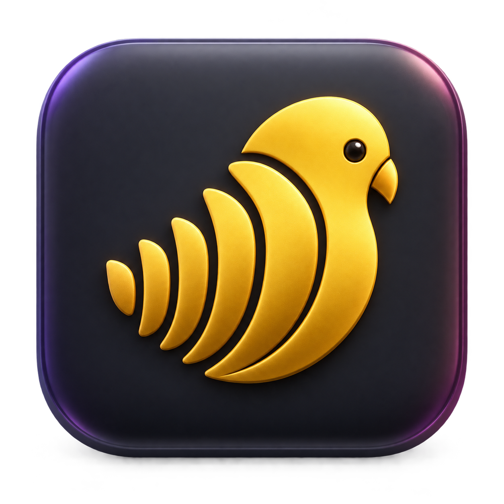

<h1 align="center">Hey, I’m Nolan.</h1>

  I build focused native macOS apps for the small annoyances that keep getting in the way.

  <strong>Swift · SwiftUI · WidgetKit · AppKit</strong> 
  Vancouver, BC

  <a href="https://nolan-mac-apps.nolankrahn.chatgpt.site"><strong>Explore the 3D software showcase →</strong></a>

## Recent apps

<table>
  <tr>
    <td width="33%" valign="top">
      

        
      

      <h3 align="center">Parakeet Transcriber</h3>
      
Fast, private transcription with batch input, live progress, and on-device Parakeet, Nemotron, and Whisper models.

      
<a href="https://nolan-mac-apps.nolankrahn.chatgpt.site/apps/parakeet"><strong>View the app →</strong></a>

    </td>
    <td width="33%" valign="top">
      

        
      

      <h3 align="center">Runway</h3>
      
A native menu bar app and WidgetKit monitor for tokens, context, limits, cost estimates, streaks, and Headroom savings.

      
<a href="https://nolan-mac-apps.nolankrahn.chatgpt.site/apps/codex-usage"><strong>View the app →</strong></a>

    </td>
    <td width="33%" valign="top">
      

        
      

      <h3 align="center">Pullr</h3>
      
A native media download queue around yt-dlp, with Chrome handoff, Apple Music matching, and local diagnostics.

      
<a href="https://nolan-mac-apps.nolankrahn.chatgpt.site/apps/pullr"><strong>View the app →</strong></a>

    </td>
  </tr>
  <tr>
    <td width="33%" valign="top">
      

      <h3 align="center">Capturely</h3>
      
Native game replay capture with a local replay buffer, clip review, and optional FrameBar performance context.

      
<a href="https://nolan-mac-apps.nolankrahn.chatgpt.site/apps/capturely"><strong>View the app →</strong></a> · <a href="https://github.com/Italian-seasoning/Capturely">Source</a>

    </td>
    <td width="33%" valign="top">
      

      <h3 align="center">FrameBar</h3>
      
CPU, RAM, GPU, and display readings in the menu bar, with a click-through overlay while Roblox is frontmost.

      
<a href="https://nolan-mac-apps.nolankrahn.chatgpt.site/apps/framebar"><strong>View the app →</strong></a> · <a href="https://github.com/Italian-seasoning/FrameBar">Source</a>

    </td>
  </tr>
</table>

## More projects

- [Homebrew tap](https://github.com/Italian-seasoning/homebrew-tap) — installation and updates for my Mac apps.
- [gooOS](https://github.com/Italian-seasoning/gooOS) — an earlier Linux OS experiment.

## How I build

- **Native** — SwiftUI first, AppKit when the native API is better.
- **Local-first** — private work stays on the Mac whenever the product allows it.
- **Focused** — one specific job, handled well, without turning into a platform.
