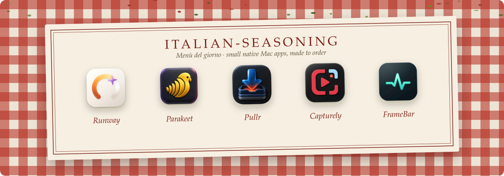
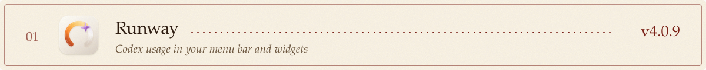
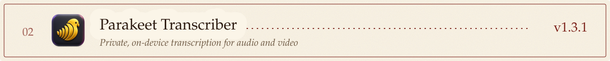
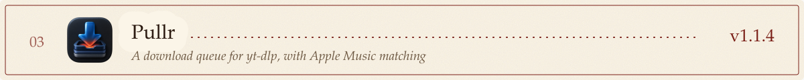
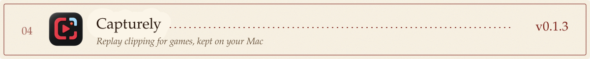
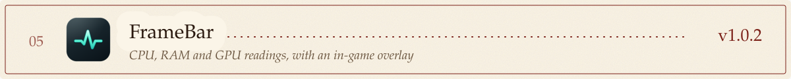

<a href="https://nolan-mac-apps.nolankrahn.chatgpt.site"></a>

# Hi, I'm Nolan

I make small, native Mac apps in Swift and SwiftUI, mostly to fix things that bug me. Based in Vancouver.

## Primi · Mac apps

<p>
<a href="https://github.com/Italian-seasoning/CodexUsageMonitor"></a>
<a href="https://github.com/Italian-seasoning/ParakeetTranscriber"></a>
<a href="https://github.com/Italian-seasoning/Pullr"></a>
<a href="https://github.com/Italian-seasoning/Capturely"></a>
<a href="https://github.com/Italian-seasoning/FrameBar"></a>
</p>

**On the showcase:** [Runway](https://nolan-mac-apps.nolankrahn.chatgpt.site/apps/codex-usage) · [Parakeet Transcriber](https://nolan-mac-apps.nolankrahn.chatgpt.site/apps/parakeet) · [Pullr](https://nolan-mac-apps.nolankrahn.chatgpt.site/apps/pullr) · [Capturely](https://nolan-mac-apps.nolankrahn.chatgpt.site/apps/capturely) · [FrameBar](https://nolan-mac-apps.nolankrahn.chatgpt.site/apps/framebar)

**To order:** every app installs with Homebrew.

```sh
brew install --cask italian-seasoning/tap/<runway | parakeet-transcriber | pullr | capturely | framebar>
```

## Contorni · other projects

- [**Bindery**](https://github.com/Italian-seasoning/bindery): build, share and install libraries of AI coding skills and prompts for Claude Code and Codex.
- [**EnhancedPresence**](https://github.com/Italian-seasoning/EnhancedPresence): Discord presence for macOS from a menu bar helper, with Apple Music and Vencord support. In beta.
- [**StudyDesk**](https://github.com/Italian-seasoning/studydesk): a local-first study desk with offline lessons, flashcards and practice tests.
- [**gooOS**](https://github.com/Italian-seasoning/gooOS): an earlier Linux OS experiment, kept for history.
